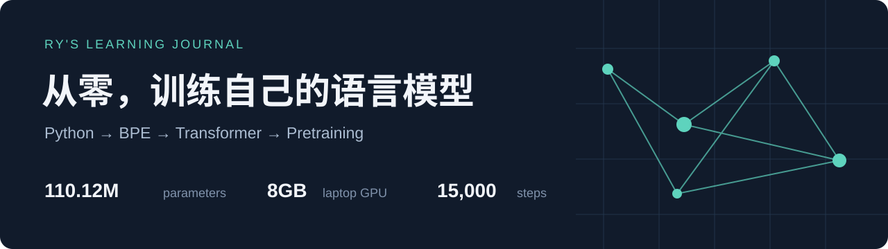
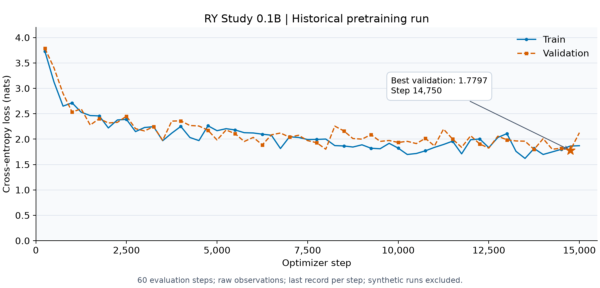

<div align="center">



# llm-ry's study · 0.1B

**从 Python 基础到 1.1 亿参数语言模型：我的学习、实现与训练记录。**


[学习过程](docs/LEARNING_JOURNEY.md) · [训练报告](docs/TRAINING_REPORT.md) · [复现指南](docs/REPRODUCING.md) · [模型卡](docs/MODEL_CARD.md) · [完整复盘](从代码到训练_完整复盘.md)

</div>

## 这个项目是什么

这是我从零学习大模型训练的实践项目。我把 Python 语法练习、手写神经网络、数据清洗、byte-level BPE 分词器、GPT 模型和训练循环放在同一个仓库，记录自己怎样把这些知识连接成一条能够运行的训练流水线。

核心实现使用 Python、NumPy 和 PyTorch，不依赖 `transformers`、`tokenizers` 或 `sentencepiece`。PyTorch 负责张量计算、自动求导和融合注意力算子；分词算法、模型结构和训练流程在仓库中实现。项目保留了代码、学习材料、原始训练指标和复盘，也记录尚待改进的问题。

**目前已完成 110,119,680 参数模型的预训练，以及命令行续写和本地网页演示。** 这是用于学习的基础语言模型，主要能力是文本续写，尚未经过指令微调（SFT）或对齐训练。

## 训练结果

| 项目 | 本次实验记录 |
|---|---|
| 模型规模 | 110,119,680 个独立参数（约 0.11B） |
| 本机硬件 | NVIDIA RTX 4060 Laptop，8GB 显存 |
| 训练进度 | 15,000 optimizer steps；每步名义处理 65,536 tokens |
| 名义训练 token 量 | 983,040,000，约 0.983B（随机窗口采样，非不重复阅读量） |
| 最佳验证 loss | **1.7797**，step 14,750；权重元数据为 1.7797412872314453 |
| 最后一次验证 loss | 2.1264，step 15,000 |
| 稳定阶段吞吐 | 控制台日志约 20.4k token/s；正式训练末段显存峰值约 6.0 GiB |
| 训练数据 | 中文维基百科 + TinyStories V2 GPT-4 英文故事 |



曲线来自 [原始指标](reports/metrics.original.csv)，排除合成数据测试，并对断点重跑产生的相同步数保留最后一次评估。显示未经平滑的观测值。验证评估每次随机抽样 40 个 batch，存在波动；最佳 loss 不是全量测试集成绩。历史梯度累积及日志字段问题见 [训练报告](docs/TRAINING_REPORT.md)。

## 我是怎样学到这里的

| 阶段 | 学习与实践 | 对应材料 |
|---|---|---|
| 01 · Python 起步 | 变量、循环、函数、容器、文件、类、生成器和 NumPy | [15 章学习材料](从0开始学python/README.md) |
| 02 · 理解神经网络 | 用纯 Python / NumPy 实现小网络，理解前向计算和梯度 | [手写神经网络](从0开始学python/project/README.md) |
| 03 · 准备数据 | 抽样检查、繁简转换、过滤、去重、哈希划分 train/val | [data_prep.py](llm0/data_prep.py) |
| 04 · 手写分词器 | 字节映射、预分词、BPE 合并、堆与链表优化、编解码测试 | [bpe.py](llm0/bpe.py) |
| 05 · 搭建模型 | RMSNorm、RoPE、因果注意力、SwiGLU、残差与权重共享 | [model.py](llm0/model.py) |
| 06 · 本机预训练 | uint16 memmap、AdamW、bf16、学习率调度、断点续训 | [训练脚本](scripts/04_train.py) |
| 07 · 检查与复盘 | 单元测试、训练曲线、实际续写、整理踩坑与不足 | [学习过程](docs/LEARNING_JOURNEY.md) |

这些材料记录学习路径与项目产物，不将课程讲义的存在等同于逐章完成记录。技术解释保留在 [《从代码到训练：完整复盘》](从代码到训练_完整复盘.md)。

## 模型结构

```text
文本 → 自训 BPE（32,768 tokens）→ Token embedding
     → 12 × [RMSNorm → Causal attention + RoPE → Residual
             → RMSNorm → SwiGLU → Residual]
     → RMSNorm → LM head（与 embedding 共享权重）→ 下一个 token
```

| 配置 | 值 |
|---|---|
| 层数 / 隐藏维度 / 注意力头 | 12 / 768 / 12（head dimension 64） |
| 上下文 / FFN 维度 | 1,024 / 2,048 |
| 位置编码 / 归一化 / 激活 | RoPE / pre-RMSNorm / SwiGLU |
| 注意力实现 | 教学版手写 attention + 训练版 PyTorch SDPA；有数值对拍测试 |
| 输出层 | 无 bias，与输入 embedding 共享权重 |

## 快速开始

使用 Python 3.11。下面对应本机已验证的 PyTorch 2.6.0 + CUDA 12.4 组合；其他硬件和系统请按 [PyTorch 官方安装说明](https://pytorch.org/get-started/locally/)选择版本。

```bash
git clone https://github.com/ssstry2635/llm-ry-study-0.1B.git
cd llm-ry-study-0.1B
python -m venv .venv
```

PowerShell 激活：`.venv\Scripts\Activate.ps1`；Linux/macOS：`source .venv/bin/activate`。

```bash
python -m pip install torch==2.6.0 --index-url https://download.pytorch.org/whl/cu124
python -m pip install -r requirements.txt
python scripts/verify_env.py
python -m pytest tests/
```

没有 GPU 也可运行多数测试；单 batch 过拟合测试会跳过。

### 体验训练好的模型

分词器已随仓库提供：`data/tokenizer/tokenizer.json`。权重下载位置和 SHA-256 见 [模型卡](docs/MODEL_CARD.md)。将 `best_model.pt` 放到 `checkpoints/012b/` 后运行：

```bash
python scripts/05_generate.py --config 012b --prompt "Once upon a time" --max-tokens 120
python scripts/05_generate.py --config 012b --prompt "从前有一座山，" --max-tokens 120
python scripts/06_demo_web.py --port 8000
```

网页位于 `http://127.0.0.1:8000`，需在本机加载权重。实际输出和采样参数见 [生成样例](docs/GENERATION_SAMPLES.md)。

### 自己从头训练

```bash
# 下载脚本面向 Windows Git Bash，需要 aria2 和 curl
bash scripts/00_download_data.sh
python scripts/01_prepare_data.py
# 已提供历史分词器；重训会替换它，之后必须重新 token 化
# python scripts/02_train_tokenizer.py
python scripts/03_tokenize_corpus.py
python scripts/04_train.py --config 012b
```

已有 checkpoint 会自动续训。数据路径、历史实现注意事项和小模型测试方法见 [复现指南](docs/REPRODUCING.md)。

## 仓库导航

```text
llm0/                   分词器、模型、配置、数据处理与采样
scripts/                下载 → 清洗 → 词表 → token 化 → 训练 → 生成 → 网页演示
tests/                  数据处理、BPE 和模型正确性测试
从0开始学python/         Python 学习讲义、示例与手写神经网络
docs/                   学习过程、训练报告、模型卡、复现指南与配图
reports/                历史指标、训练日志、清洗统计与权重清单
data/tokenizer/          与本次模型配套的 BPE 词表
ROADMAP.md              当前进度和后续计划
从代码到训练_完整复盘.md   原始技术复盘（附公开整理校注）
```

原始语料、清洗全文、token 二进制、虚拟环境和训练断点不进入 Git 历史。数据来源及其原始许可见 [数据说明](docs/DATA.md)。

## 下一步

- [ ] 规范梯度累积的 loss 缩放，与历史实现做受控比较。
- [ ] 固定评估随机种子，分别报告中文 / 英文验证指标。
- [ ] 改善训练日志字段、run 隔离和数据采样的可复现性。
- [ ] 加入 KV cache，测量推理速度与显存占用。
- [ ] 尝试小规模 SFT，观察续写模型与指令模型的差异。

欢迎围绕代码正确性、实验记录和学习方法提出 Issue。这个仓库会继续记录我学习训练大模型的过程。
