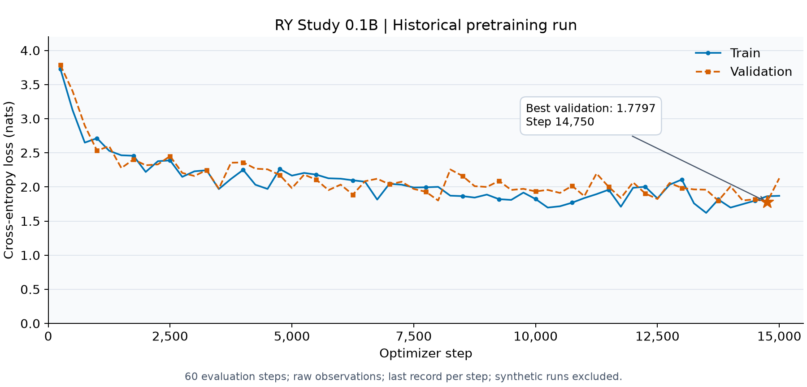

# 0.1B 预训练实验报告

## 实验与证据

正式训练日志日期为 **2026-09-21 至 2026-09-22**，年份由 CSV Unix 时间戳核对。首次正式启动为 09-21 21:09:37，最终完成为 09-22 19:49:21，墙钟跨度约 22 小时 40 分，包含中断、续训、重跑和休息。原始复盘中的「约 13 小时」是训练量 / 吞吐的粗估，不是完整墙钟耗时。

| 证据文件 | 用途 |
|---|---|
| [metrics.original.csv](../reports/metrics.original.csv) | 原始追加式 CSV，包含合成数据试跑和重复步数 |
| [metrics.training.csv](../reports/metrics.training.csv) | 作图指标，每步保留最后一次正式评估 |
| [train_012b.log](../reports/train_012b.log) | 启动、吞吐、评估和续训记录 |
| [data_stats.json](../reports/data_stats.json) | 清洗统计；`est_tokens` 是估算 |
| [checkpoint_manifest.json](../reports/checkpoint_manifest.json) | 权重元数据、大小与 SHA-256 |

## 配置

| 类别 | 数值 |
|---|---|
| 参数 / 结构 | 110,119,680；12 层 × 768；12 头；FFN 2,048 |
| 词表 / 上下文 | 32,768 / 1,024 |
| micro-batch / grad accumulation | 4 / 16 |
| 名义每步 token | 4 × 1,024 × 16 = 65,536 |
| 优化器 | AdamW，betas=(0.9, 0.95)，矩阵参数 weight decay=0.1 |
| 学习率 | 峰值 4e-4；warmup 300 步；cosine 降至 4e-5 |
| 数值与裁剪 | CUDA bf16 autocast；梯度 norm 裁剪 1.0 |
| 评估 | 每 250 步；train / val 各随机抽取 40 个 batch |
| 断点 | 每 500 步和最终步保存模型、优化器及进度 |
| 数据量 | train 1,421,745,504；val 14,351,504 tokens |

15,000 × 65,536 = **983,040,000 tokens** 是名义训练预算。采样有放回，断点恢复也可能重复处理部分步数，不等同于唯一 token 数或完整 epoch 数。

## 结果



正式训练 CSV 有 62 条评估记录、60 个唯一步数，范围 250–15,000。第 3,250 与 9,750 步各出现两次，来自断点重跑。图中每步保留最后一条，不平滑，不混入 21 / 41 步合成试跑。图中没有初始化点；`ln(32768)≈10.40` 仅是均匀预测参考基线。

| 时点 | Train loss | Val loss |
|---|---:|---:|
| 250 | 3.7268 | 3.7858 |
| 1,000 | 2.7136 | 2.5322 |
| 5,000 | 2.1658 | 1.9823 |
| 10,000 | 1.8222 | 1.9346 |
| 14,750（最佳） | 1.8637 | **1.7797** |
| 15,000（最终） | 1.8697 | 2.1264 |

最佳 checkpoint 记录 `iter=14750`、`val_loss=1.7797412872314453`，与 CSV 一致。推理默认优先加载 `best_model.pt`。

## 评估边界

这是单次学习实验，没有多随机种子重复实验、固定全量测试集或外部 benchmark。每次评估采样不同窗口，混合中英文又有不同难度，局部波动和 train / val 交叉不能直接归因为过拟合或发散。

按文档哈希划分阻止完全相同的清洗后文档跨集合；没有语义近重复、长片段重叠或 benchmark 污染检查。未分别测量中文 / 英文 loss，混合 loss 不能代表单独语言能力。

## 历史实现问题

1. **梯度累积未平均。** 每个 micro-batch 直接 `loss.backward()`，没有除以 `grad_accum`。裁剪前梯度尺度是均值的 16 倍，会影响裁剪与 AdamW 状态。保留历史实现以对应已有权重；规范版本应独立记录。
2. **CSV 字段语义错误。** `tok_per_s` 实际写入评估时窗口剩余 token 计数，`elapsed_s` 实际为 Unix 时间戳。图表只用步数与 loss；吞吐取自控制台日志。
3. **没有固定训练 / 评估随机种子。** 断点不保存 RNG 状态，不能逐位复现。
4. **词表样本偏向文件前部。** 顺序读取训练文件，而清洗时先写中文再写英文，不是均衡语言采样。
5. **试跑与正式实验共用日志。** 需依据数据量与步数区分早期合成数据。

## 重新生成图表

```bash
python -m pip install -r requirements-viz.txt
python scripts/07_plot_training.py
```

脚本从原始指标提取正式数据，导出 PNG / SVG，不做平滑；颜色、线型和 marker 同时区分两组曲线。
